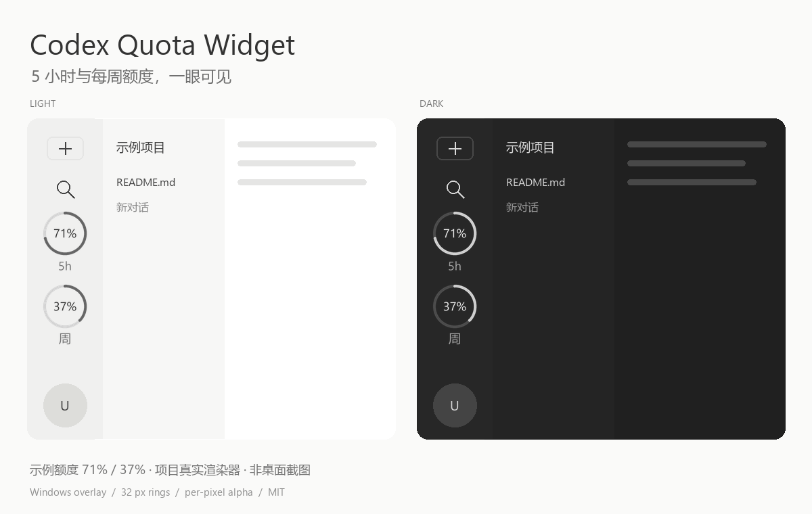

# Codex Quota Widget

轻量的 Windows 额度浮窗：在 Codex 左下角头像上方，用两个小圆环查看 **5 小时**和**每周**剩余额度。

[下载 Windows 便携包](https://github.com/HJQ0216/codex-quota-widget/releases/latest) · [MIT 许可证](LICENSE)



> 图片使用项目实际渲染器生成，展示示例额度 71% / 37%；侧栏背景是排版示意，**不是 Codex 桌面截图**。

## 特点

- 两个直径 32 逻辑像素的圆环，剩余百分比居中，垂直排列。
- 真正的逐像素透明背景，透出侧栏原有颜色。
- 圆环与文字采用 4 倍超采样和 Lanczos 缩小，减少锯齿与黑边。
- 每 60 秒查询一次；点击刷新，悬停查看重置时间，右键退出。
- 跟随 Codex 窗口和显示缩放；切换应用或最小化时隐藏。
- 不修改 Codex 安装文件、配置或开机启动项。

## 下载运行

1. 安装 Codex Windows 桌面客户端，使用 ChatGPT 账号登录。
2. 在 [Releases](https://github.com/HJQ0216/codex-quota-widget/releases/latest) 下载 `codex-quota-widget-v0.1.0-windows-x64.zip`。
3. 将整个压缩包解压到可写目录，双击 `CodexQuotaWidget.exe`。便携包自带 Python 运行时，无需单独安装 Python。
4. 切回 Codex，在左下角头像上方查看圆环。右键圆环可退出。

不要只移动 `.exe`：旁边的 `_internal` 文件夹也是程序的一部分。

## 从源码运行

需要 Windows、Python **3.11+（包含 Tk）**，以及已登录的 Codex 桌面客户端。

```powershell
git clone https://github.com/HJQ0216/codex-quota-widget.git
cd codex-quota-widget
.\install.cmd
.\start.cmd
```

依赖安装到项目自己的 `lib/`；安装缓存、临时文件在 `runtime/`，不做全局 Python 安装。
如已在当前 Python 环境安装依赖，也可直接执行 `python -B widget.py`。

程序优先从 `PATH` 查找 `codex.exe`，然后查找桌面客户端在 `%LOCALAPPDATA%\OpenAI\Codex\bin` 的本地二进制缓存。

## 额度与登录信息

通过本地 Codex app-server 的 [`account/rateLimits/read`](https://learn.chatgpt.com/docs/app-server) 查询当前账号额度；组件不会启动模型对话。

- 按窗口长度 300 / 10080 分钟识别 5 小时与周额度。
- 剩余百分比 = `100 - usedPercent`；服务端未提供的数据以 `—` 显示。
- 查询失败时显示琥珀色状态，悬停可查看原因，不把旧数据当作最新值。
- 只读现有 `CODEX_HOME/auth.json`，默认 `%USERPROFILE%\.codex\auth.json`。
- 访问令牌在内存中经本地 stdin 传给 app-server，不复制登录文件、不把令牌写入组件状态文件、不上传给项目作者。
- 独立 app-server 直接联系 Codex 服务完成查询；令牌续期由原 Codex 客户端负责。
- 仅支持已有 ChatGPT 登录的使用方式；API key 登录不提供这里展示的订阅额度。

`chatgptAuthTokens` 是实验性接口，后续 Codex 更新可能需要适配。本项目与 OpenAI 无隶属关系。

## 适用范围与限制

- 当前在 **Windows 10 22H2 x64 / Python 3.13 / 125% 缩放**完成本机运行验证。
- 布局与透明像素检查覆盖 100%、125%、150%、200%；Windows 11 尚未单独实测。
- 这是独立浮窗，会覆盖该位置原有的内容，不能让原生侧栏腾出空间。
- 位置按当前桌面版侧栏布局对齐；侧栏收起、定制主题或后续界面更新可能需要调整。
- 深浅配色优先参考窗口主题标志，回退到 Windows 应用主题；定制主题的文字颜色不保证完全匹配。
- 不支持 macOS / Linux。桌面全屏截图验收未完成；仓库效果图明确标注为渲染示意图。

## 验证与打包

```powershell
python -B tools\verify.py
python -B tools\render_preview.py
python -B -m pip install pyinstaller==6.22.3
python -B tools\build_windows.py
```

验证包含额度解析、32 组 DPI/主题/状态组合、文字边界、半透明边缘和 Windows 原生透明合成。输出放在忽略的 `build/` 或 `dist/` 中；不会读取真实账号数据来制作效果图。

源码入口是 `widget.py`，抗锯齿与 Windows 透明绘制在 `rendering.py`。

## 许可证

[MIT](LICENSE)。便携包中的第三方组件保留各自许可证，见 [THIRD_PARTY_NOTICES.md](THIRD_PARTY_NOTICES.md)。
